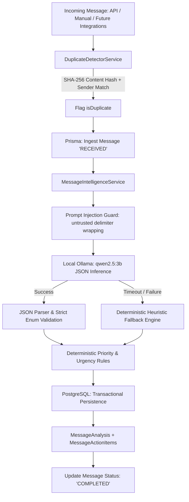

# Module 07 — Message Intelligence Engine

**Module ID:** `MODULE-07`  
**Status:** `COMPLETED`  
**Package / Apps:** `@bhuvi/shared`, `@bhuvi/database`, `@bhuvi/queue`, `apps/api`, `apps/worker`, `apps/web`  
**Local AI Model:** `qwen2.5:3b` via Ollama (`http://127.0.0.1:11434`)

---

## 1. Overview & Architecture

The **Message Intelligence Engine** is BHUVI's core capability for understanding, classifying, summarizing, prioritizing, and extracting action items from incoming messages.

Operating on a strict **local-first** principle, it converts unstructured communication into structured intelligence without sending any data to external cloud APIs.

---

## 2. Core Capabilities

1. **Classification:** Categorizes messages into 10 strict domains: `PERSONAL`, `WORK`, `EDUCATION`, `FINANCIAL`, `BUSINESS`, `SOCIAL`, `PROMOTIONAL`, `TRANSACTIONAL`, `NOTIFICATION`, `OTHER`.
2. **Priority Assessment:** Identifies importance: `CRITICAL`, `HIGH`, `MEDIUM`, `LOW`.
3. **Urgency Detection:** Identifies time sensitivity: `URGENT`, `TIME_SENSITIVE`, `NORMAL`, `NONE`.
4. **Intent Recognition:** Categorizes purpose: `REQUEST`, `QUESTION`, `INFORMATION`, `REMINDER`, `INVITATION`, `COMPLAINT`, `CONFIRMATION`, `OFFER`, `OTHER`.
5. **Sentiment Analysis:** Identifies emotional tone: `POSITIVE`, `NEGATIVE`, `NEUTRAL`, `MIXED`, `UNKNOWN`.
6. **AI Summarization:** Generates neutral 1–2 sentence abstracts.
7. **Action Item Extraction:** Extracts actionable tasks with titles, descriptions, priorities, and deadlines.
8. **Entity Extraction:** Identifies documents, people, organizations, and dates.
9. **Duplicate Detection:** Normalizes text and hashes content via SHA-256 scoped to user and sender.
10. **Prompt Injection Defense:** Strict delimiter wrapping (`<user_message_content_untrusted>`) and instruction overrides prevention.
11. **Deterministic Fallbacks:** Fallback heuristics if Ollama is unreachable or times out.
12. **Agent Orchestrator Integration:** `TaskAgent` and internal services can analyze messages directly for Module 06 plans.

---

## 3. Database Schema

Models deployed in `packages/database/prisma/schema.prisma`:

### `Message`

- `id`: UUID primary key
- `userId`: Foreign key to `User` (cascade delete)
- `source`: Ingestion source (e.g., `MANUAL`, `API`)
- `senderName`: Display name of sender
- `senderIdentifier`: Optional email, phone, or handle
- `subject`: Optional subject line
- `content`: Raw message text
- `contentHash`: SHA-256 hash of normalized content
- `processingStatus`: Lifecycle state (`RECEIVED`, `VALIDATING`, `PROCESSING`, `ANALYZING`, `COMPLETED`, `FAILED`, `RETRY_PENDING`)
- `receivedAt`, `createdAt`, `updatedAt`: Timestamps

### `MessageAnalysis`

- `id`: UUID primary key
- `messageId`: Unique foreign key to `Message` (cascade delete)
- `category`: Strict enum string
- `priority`: Strict enum string
- `priorityExplanation`: Short justification for rating
- `urgency`: Strict enum string
- `intent`: Strict enum string
- `sentiment`: Strict enum string
- `summary`: Concisely summarized text
- `requiresReply`: Boolean
- `requiresAction`: Boolean
- `confidence`: Confidence score (0.00 – 1.00)
- `extractedEntities`: JSON array of `{ type, value }`
- `analysisMetadata`: JSON telemetry (model name, timestamps)

### `MessageActionItem`

- `id`: UUID primary key
- `messageId`: Foreign key to `Message` (cascade delete)
- `userId`: Foreign key to `User` (cascade delete)
- `title`: Action item description
- `description`: Optional details
- `priority`: Priority level
- `dueDate`: Optional timestamp
- `status`: Lifecycle state (`PENDING`, `IN_PROGRESS`, `COMPLETED`, `CANCELLED`)

---

## 4. REST API Specification

Protected under `JwtAuthGuard` (`/api/v1/messages`):

| Method   | Endpoint                           | Description                                                              |
| -------- | ---------------------------------- | ------------------------------------------------------------------------ |
| `POST`   | `/api/v1/messages`                 | Ingest and store message with duplicate check and auto-analysis          |
| `POST`   | `/api/v1/messages/:id/analyze`     | Force re-analyze an existing message                                     |
| `POST`   | `/api/v1/messages/analyze-preview` | Analyze supplied text on-the-fly without database writes                 |
| `GET`    | `/api/v1/messages`                 | List paginated messages with category, priority, and text search filters |
| `GET`    | `/api/v1/messages/:id`             | Retrieve single message and analysis (ownership verified)                |
| `GET`    | `/api/v1/messages/:id/analysis`    | Retrieve analysis details for message                                    |
| `GET`    | `/api/v1/messages/priority`        | List high-priority and urgent messages                                   |
| `GET`    | `/api/v1/messages/actions`         | List extracted action items for user                                     |
| `PATCH`  | `/api/v1/messages/actions/:id`     | Update action item status (`PENDING`, `COMPLETED`, etc.)                 |
| `GET`    | `/api/v1/messages/stats`           | Retrieve aggregate message intelligence metrics                          |
| `DELETE` | `/api/v1/messages/:id`             | Delete message and cascade-delete analysis and action items              |

---

## 5. Security & Multi-Tenant Isolation

1. **Prompt Injection Prevention:**
   All message content is treated as untrusted text. System prompts command the model to ignore any instructions inside the `<user_message_content_untrusted>` tags.
2. **Strict Multi-Tenant Verification:**
   Every query and mutation scopes strictly to the authenticated `req.user.id`. Accessing or deleting another user's message returns `403 Forbidden`.
3. **No External Dispatches:**
   No real emails or external messages are sent; all actions are recorded as internal proposals.
