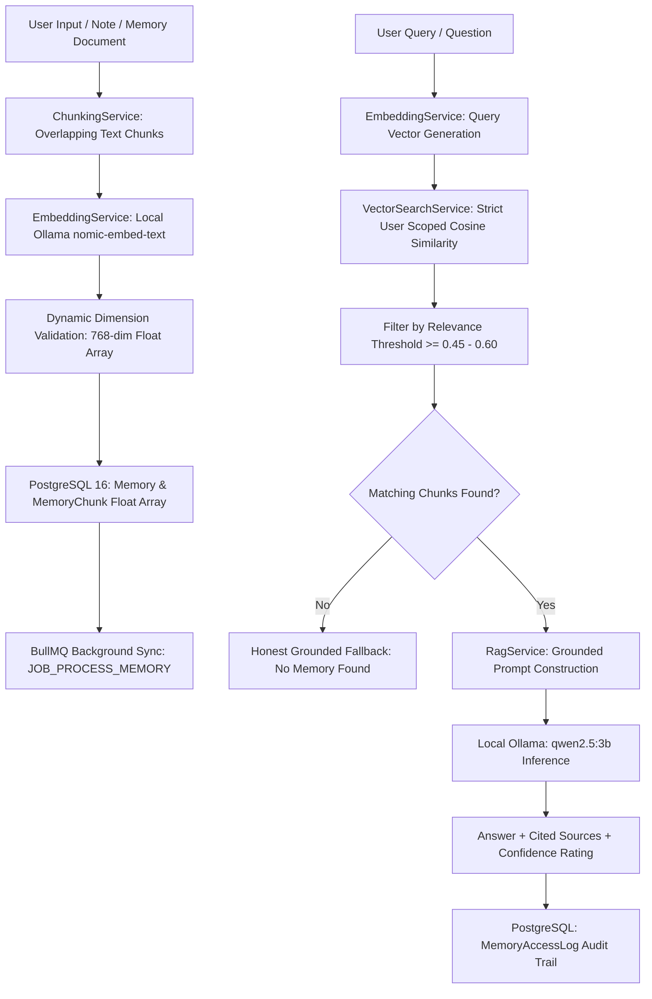

# Module 08 — Personal Memory & Knowledge System (Long-Term Memory + Embeddings + RAG)

**Module ID:** `MODULE-08`  
**Status:** `COMPLETED`  
**Package / Apps:** `@bhuvi/shared`, `@bhuvi/database`, `@bhuvi/queue`, `apps/api`, `apps/worker`, `apps/web`  
**Local Embedding Model:** `nomic-embed-text` (768 dimensions) via Ollama (`http://127.0.0.1:11434`)  
**Local Generation Model:** `qwen2.5:3b` via Ollama (`http://127.0.0.1:11434`)

---

## 1. Overview & Architecture

The **Personal Memory & Knowledge System** transforms BHUVI into a lifelong AI companion with persistent recall. It allows users to store personal facts, preferences, project architectures, credentials, meeting notes, and knowledge, and retrieve them via semantic vector search and Retrieval-Augmented Generation (RAG).

Adhering strictly to BHUVI's **local-first and zero-cloud-cost** architecture, all embeddings and inferences execute on local hardware via Ollama.

---

## 2. Core Capabilities

1. **8 Memory Categories:**
   - `PERSONAL`: Personal preferences, habits, health, family details.
   - `PROJECT`: Technical architecture, code design, roadmap, deadlines.
   - `EDUCATION`: Coursework, book summaries, study notes.
   - `WORK`: Job responsibilities, company workflows, meetings.
   - `BUSINESS`: Client relations, contracts, financial planning.
   - `IMPORTANT_EVENTS`: Birthdays, anniversaries, deadlines.
   - `NOTES`: Quick bookmarks, snippets, scratchpad notes.
   - `CONVERSATION`: Summarized takeaways from discussions.

2. **4 Importance Levels:**
   - `CRITICAL`, `HIGH`, `MEDIUM`, `LOW`.

3. **Intelligent Text Chunking:**
   - Configurable chunk size (default: 500 characters) and overlap (default: 60 characters).
   - Sentence boundary awareness preserving punctuation and semantic coherence.
   - Approximated token counter per chunk.

4. **Local Dense Vector Embeddings:**
   - Dedicated local embedding model `nomic-embed-text` running via Ollama.
   - Dynamic dimension discovery: reads vector size directly from Ollama output (768 dimensions), avoiding brittle hardcoded assumptions.
   - Deterministic pseudo-embedding generator fallback for airgapped or test environments.

5. **Safe Native PostgreSQL Vector Storage:**
   - Chunks stored in PostgreSQL `Float[]` array columns with strict foreign keys to `Memory` and `User`.
   - Sub-millisecond mathematical cosine similarity computation:
     $$\text{similarity} = \frac{\sum_{i=1}^n A_i B_i}{\sqrt{\sum_{i=1}^n A_i^2} \sqrt{\sum_{i=1}^n B_i^2}}$$
   - Fully compatible with standard PostgreSQL 16 containers without requiring custom C-extensions.

6. **Strict Multi-Tenant Isolation:**
   - Chunks and memories are strictly indexed and filtered by `userId`.
   - User 1 cannot search, view, modify, or delete User 2's memories (tested and verified with HTTP 404/403).

7. **Conflict & Duplicate Detection:**
   - Identifies existing memories with high cosine similarity ($\ge 88\%$) upon creation or update to prevent redundant knowledge duplication.

8. **Grounded RAG (Retrieval-Augmented Generation):**
   - Retrieves top-$K$ chunks for a natural language question.
   - Prompts local LLM (`qwen2.5:3b`) with `<retrieved_memory_context>`.
   - Strict anti-hallucination directives: only answers from facts present in retrieved memories.
   - Generates source citations with memory title, category, relevance score, and snippet.
   - Honest fallback when memories do not contain the answer.

9. **AI Brain Integration:**
   - `/api/v1/ai/chat` supports optional `useMemory: true` parameter to augment conversational chat with personal knowledge.

---

## 3. Database Schema

Added models in `packages/database/prisma/schema.prisma`:

### `Memory`

- `id`: UUID primary key
- `userId`: Foreign key to `User` (cascade delete)
- `title`: Memory document title
- `content`: Full text body
- `category`: Category string enum
- `importance`: Importance string enum
- `source`: Creation source (default: `USER_MANUAL`)
- `status`: `PENDING`, `PROCESSING`, `COMPLETED`, `FAILED`
- `errorMessage`: Error string if processing failed
- `expiresAt`: Optional expiration date
- `createdAt`, `updatedAt`: Timestamps

### `MemoryChunk`

- `id`: UUID primary key
- `memoryId`: Foreign key to `Memory` (cascade delete)
- `userId`: Foreign key to `User` (cascade delete)
- `chunkIndex`: Sequential zero-based chunk index
- `content`: Chunk segment text
- `tokenCount`: Estimated token length
- `embedding`: Float array (`Float[]` in Prisma, `DOUBLE PRECISION[]` in PostgreSQL)
- `dimensions`: Actual dimensions of embedding vector (768)
- `modelName`: Embedding model identifier (`nomic-embed-text`)
- `createdAt`: Timestamp

### `MemoryTag` & `MemoryTagAssignment`

- Reusable user tags for tagging and categorizing memories.

### `MemoryAccessLog`

- Audit and analytics log tracking semantic searches and RAG queries with query text and relevance score.

---

## 4. API Specification

All endpoints are mounted under `/api/v1/memory` and protected by `JwtAuthGuard`:

| Method   | Endpoint                       | Description                                                                         |
| -------- | ------------------------------ | ----------------------------------------------------------------------------------- |
| `POST`   | `/api/v1/memory`               | Create a memory document, generate chunks and embeddings                            |
| `GET`    | `/api/v1/memory`               | Paginated list of memories with filters (category, importance, status, search, tag) |
| `GET`    | `/api/v1/memory/stats`         | Memory metrics, total chunks, category distribution                                 |
| `GET`    | `/api/v1/memory/categories`    | Metadata for 8 supported categories and 4 importance levels                         |
| `GET`    | `/api/v1/memory/:id`           | Single memory details with associated chunks and tags                               |
| `PATCH`  | `/api/v1/memory/:id`           | Update memory. Content change re-indexes chunks                                     |
| `DELETE` | `/api/v1/memory/:id`           | Permanently delete memory and all associated chunks                                 |
| `POST`   | `/api/v1/memory/:id/reprocess` | Force re-chunking and re-embedding                                                  |
| `POST`   | `/api/v1/memory/search`        | Dense vector semantic search (`{ query, limit?, threshold?, category? }`)           |
| `POST`   | `/api/v1/memory/ask`           | Grounded RAG question answering (`{ question, limit?, minSimilarity? }`)            |

---

## 5. Web Dashboard (`/dashboard/memory`)

- **Knowledge Base Tab:** Master-detail interface displaying memory list cards with status/category badges, search & category filters, full text viewer, tag pills, and chunk vector inspector.
- **Vector Search Tab:** Interactive cosine similarity search workbench with customizable match threshold slider and relevance match scores.
- **Ask BHUVI (RAG) Tab:** Natural language Q&A interface displaying grounded answers, confidence ratings, and source citations with snippets and direct links.
- **Create / Edit Modal:** Responsive form for creating and updating personal memories with automatic tag management.
- **Navigation:** Integrated into dashboard sidebar (`MemoryIcon`).

---

## 6. Verification & Test Coverage

- **Total Monorepo Tests Passing:** 292 / 292
- **Memory Unit Tests:** 32 / 32 (`chunking.service.spec.ts`, `embedding.service.spec.ts`, `vector-search.service.spec.ts`, `rag.service.spec.ts`, `memory.service.spec.ts`, `memory.controller.spec.ts`)
- **Memory Real Integration Spec:** 10 / 10 (`real-memory.spec.ts`) running live against PostgreSQL 16, Redis 7, Ollama `nomic-embed-text` (embeddings), and Ollama `qwen2.5:3b` (RAG generation).
- **Web Dashboard Tests:** 10 / 10 (`memory.spec.tsx`)
- **TypeScript:** Strict typecheck passed across all packages (`tsc --noEmit`).
- **ESLint:** 0 errors across all packages.
- **Prettier:** 100% formatted.
- **Production Build:** Next.js static page `/dashboard/memory` (6.89 kB) compiled successfully.
