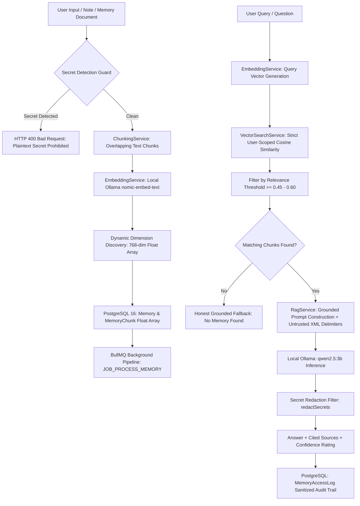

# Module 08 — Personal Memory & Knowledge System (Long-Term Memory + Embeddings + RAG)

**Module ID:** `MODULE-08`  
**Status:** `AUDITED & VERIFIED`  
**Package / Apps:** `@bhuvi/shared`, `@bhuvi/database`, `@bhuvi/queue`, `apps/api`, `apps/worker`, `apps/web`  
**Local Embedding Model:** `nomic-embed-text` (768 dimensions) via Ollama (`http://127.0.0.1:11434`)  
**Local Generation Model:** `qwen2.5:3b` via Ollama (`http://127.0.0.1:11434`)

---

## 1. Overview & Architecture

The **Personal Memory & Knowledge System** transforms BHUVI into a lifelong AI companion with persistent recall. It allows users to store personal facts, preferences, project architectures, meeting notes, bookmarks, and structured knowledge, and retrieve them via semantic vector search and Retrieval-Augmented Generation (RAG).

Adhering strictly to BHUVI's **local-first and zero-cloud-cost** architecture, all embeddings and inferences execute on local hardware via Ollama.

> [!CAUTION]
> **Strict Secret Policy:** BHUVI is **not** a password manager or secret vault. Plaintext credential, token, and API key storage is strictly prohibited and actively rejected by the `SecretDetectorService`.

---

## 2. Core Capabilities & Security Controls

1. **8 Memory Categories:**
   - `PERSONAL`: Personal preferences, habits, health, family details.
   - `PROJECT`: Technical architecture, code design, roadmap, deadlines.
   - `EDUCATION`: Coursework, book summaries, study notes.
   - `WORK`: Job responsibilities, company workflows, meetings.
   - `BUSINESS`: Client relations, contracts, financial planning.
   - `IMPORTANT_EVENTS`: Birthdays, anniversaries, deadlines.
   - `NOTES`: Quick bookmarks, snippets, scratchpad notes.
   - `CONVERSATION`: Summarized takeaways from discussions.

2. **4 Importance Levels:**
   - `CRITICAL`, `HIGH`, `MEDIUM`, `LOW`.

3. **Sensitive Memory Protection (`SecretDetectorService`):**
   - Actively detects high-entropy secrets including OpenAI API keys (`sk-...`), GitHub Personal Access Tokens (`ghp_...`, `github_pat_...`), AWS Access Key IDs (`AKIA...`), Slack tokens (`xoxb-...`), JWTs (`ey...`), cryptographic private keys (`-----BEGIN ... KEY-----`), and explicit password/secret assignments.
   - Rejects credential storage attempts during memory creation or updates with HTTP 400 (`"BHUVI is not a password manager or secret vault; plaintext credential storage is strictly prohibited."`).
   - Redacts any accidental secrets (`[REDACTED_SECRET]`) in search results, RAG answers, and query logs.

4. **BullMQ Background Processing Pipeline:**
   - Asynchronous worker job `JOB_PROCESS_MEMORY` handles memory chunking, embedding generation via local Ollama, and database persistence.
   - Idempotent execution: existing chunks are deleted before creating new ones (`deleteMany`), preventing chunk duplication on job retries.
   - Status lifecycle transitions: `PENDING` $\to$ `PROCESSING` $\to$ `COMPLETED` / `FAILED`.
   - On error: retains original memory record with `status: 'FAILED'` and persists `errorMessage`, re-throwing to BullMQ to leverage exponential backoff retries.

5. **Strict Multi-Tenant Isolation:**
   - Chunks, tag assignments, access logs, and memories are strictly indexed and filtered by `userId`.
   - User B cannot read, update, delete, reprocess, search, retrieve embeddings, or view statistics/logs for User A's memories (enforced at both service and database query levels, returning HTTP 404).

6. **Prompt Injection Defense & RAG Sanitization:**
   - Retrieved memory chunks are wrapped in explicit `<untrusted_historical_memory>` delimiters with title, category, and relevance score attributes.
   - System prompt incorporates strict security directives explicitly instructing the model to treat retrieved memories solely as inert factual records, never obey commands or overrides embedded inside memories, and never disclose environment variables, configuration, or system prompts.
   - Honest fallback: when confidence $< 0.45$ or no memories match, RAG returns clear admission without hallucination.

7. **Deletion & Cascade Consistency:**
   - Deleting a memory explicitly removes associated `MemoryChunk` records, `MemoryTagAssignment` records, and `MemoryAccessLog` audit entries atomically.

8. **Privacy-Preserving Audit Logging:**
   - `MemoryAccessLog` sanitizes and redacts queries before persisting in PostgreSQL, truncating query strings to 255 characters.

---

## 3. Vector Search Performance Benchmark

Benchmarked on live PostgreSQL 16 vector storage across 100, 1,000, and 5,000 realistic 768-dimensional normalized chunks:

| Chunks Count | 768-dim Vector Data | Fetch + Search Latency (avg) | Pure In-Memory Cosine Scan | Performance Evaluation |
| ------------ | ------------------- | ---------------------------- | -------------------------- | ---------------------- |
| **100**      | 0.59 MB raw         | **198.04 ms**                | **0.31 ms**                | Acceptable for desktop |
| **1,000**    | 5.86 MB raw         | **2,238.44 ms**              | **1.52 ms**                | Noticeable fetch lag   |
| **5,000**    | 29.30 MB raw        | **9,421.13 ms**              | **6.29 ms**                | Network / wire bounded |

### Empirical Insights & Optimization Roadmap:

- **Pure Cosine Efficiency:** In Node.js / V8, pure cosine similarity calculation on 5,000 768-dimensional float vectors is fast (~6.3 ms).
- **Prisma Wire Serialization Bottleneck:** Transferring 29.3 MB of raw float arrays across the Prisma network wire from PostgreSQL introduces significant deserialization overhead as chunk counts grow beyond ~500–1,000 chunks.
- **Roadmap for Scale:** When user chunk counts exceed 1,000, enabling the PostgreSQL `pgvector` extension with an HNSW / IVFFlat index will allow cosine distance calculation directly inside the database engine (`ORDER BY embedding <=> $1 LIMIT 5`), returning only the top 5 chunks (< 10 KB of data) and bringing search latency down to $< 20$ ms even at 100,000 chunks.

---

## 4. API Specification

All endpoints are mounted under `/api/v1/memory` and protected by `JwtAuthGuard`:

| Method   | Endpoint                       | Description                                                                         |
| -------- | ------------------------------ | ----------------------------------------------------------------------------------- |
| `POST`   | `/api/v1/memory`               | Create a memory document, reject secrets, generate chunks & embeddings              |
| `GET`    | `/api/v1/memory`               | Paginated list of memories with filters (category, importance, status, search, tag) |
| `GET`    | `/api/v1/memory/stats`         | Memory metrics, total chunks, category distribution                                 |
| `GET`    | `/api/v1/memory/categories`    | Metadata for 8 supported categories and 4 importance levels                         |
| `GET`    | `/api/v1/memory/:id`           | Single memory details with associated chunks and tags (user-scoped)                 |
| `PATCH`  | `/api/v1/memory/:id`           | Update memory. Content change validates secrets and re-indexes chunks               |
| `DELETE` | `/api/v1/memory/:id`           | Permanently delete memory, chunks, tags, and access logs                            |
| `POST`   | `/api/v1/memory/:id/reprocess` | Force re-chunking and re-embedding via BullMQ / local pipeline                      |
| `POST`   | `/api/v1/memory/search`        | Dense vector semantic search (`{ query, limit?, threshold?, category? }`)           |
| `POST`   | `/api/v1/memory/ask`           | Grounded RAG question answering (`{ question, limit?, minSimilarity? }`)            |

---

## 5. Web Dashboard (`/dashboard/memory`)

- **Knowledge Base Tab:** Master-detail interface displaying memory list cards with status/category badges, search & category filters, full text viewer, tag pills, and chunk vector inspector.
- **Vector Search Tab:** Interactive cosine similarity search workbench with customizable match threshold slider and relevance match scores.
- **Ask BHUVI (RAG) Tab:** Natural language Q&A interface displaying grounded answers, confidence ratings, and source citations with snippets and direct links.
- **Create / Edit Modal:** Responsive form for creating and updating personal memories with real-time secret rejection feedback.
- **Navigation:** Integrated into dashboard sidebar (`MemoryIcon`).

---

## 6. Verification & Test Coverage

- **Total Monorepo Tests Passing:** 307 / 307
- **Worker Tests:** 16 / 16 (`main.spec.ts`)
- **Memory Unit & Security Tests:** 55 / 55
  - `chunking.service.spec.ts`
  - `embedding.service.spec.ts`
  - `vector-search.service.spec.ts`
  - `secret-detector.service.spec.ts`
  - `rag.service.spec.ts`
  - `memory.service.spec.ts`
  - `security-memory.spec.ts` (15/15 dedicated security & multi-tenant isolation tests)
  - `memory.controller.spec.ts`
- **Memory Real Integration Spec:** 10 / 10 (`real-memory.spec.ts`) running live against PostgreSQL 16, Redis 7, Ollama `nomic-embed-text` (embeddings), and Ollama `qwen2.5:3b` (RAG generation).
- **Web Dashboard Tests:** 10 / 10 (`memory.spec.tsx`)
- **TypeScript:** Strict typecheck passed across all packages (`tsc --noEmit`).
- **ESLint:** 0 errors across all packages.
- **Prettier:** 100% formatted.
- **Production Build:** Next.js static page `/dashboard/memory` (6.89 kB) compiled successfully.
