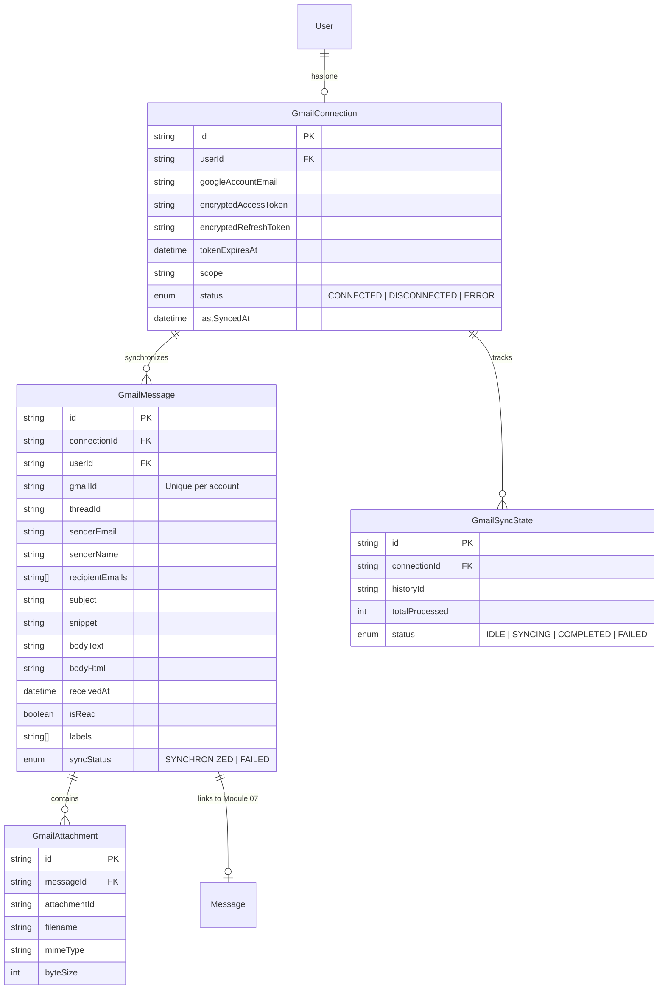

# BHUVI — Module 09: Gmail Integration Architecture & Implementation Guide

## 1. Executive Summary

Module 09 implements official, secure, local-first Gmail integration for BHUVI (Brain for Human Virtual Intelligence). Built upon the official Google APIs (`googleapis`), OAuth 2.0 Authorization Code flow with state verification, AES-256-GCM encrypted token storage, and BullMQ background workers, Module 09 enables BHUVI to synchronize user emails, perform local AI analysis (via Ollama `qwen2.5:3b`), extract actionable tasks, draft replies safely without auto-sending, and query inbox history through conversational RAG.

---

## 2. Core Architecture & Design Principles

### 2.1 Zero-Budget & Local-First

- **No Third-Party Paid Services**: Uses direct Google Gmail REST API via official client libraries (`googleapis`). No Nylas, no Aurinko, no paid SaaS wrappers.
- **Local AI Processing**: Email summarization, action item extraction, reply suggestions, and semantic search run entirely on the local machine via Ollama.
- **Privacy First**: Sensitive email text is parsed locally and never dispatched to external cloud AI endpoints.

### 2.2 Strict Safety & User Control

- **Drafts Only (No Auto-Send)**: Requested OAuth scopes include `https://www.googleapis.com/auth/gmail.compose` strictly for creating user drafts (`gmail.users.drafts.create`). Auto-sending, forwarding, and replying are prohibited by design. The user retains complete authority to review, edit, and send emails directly from the official Gmail interface.
- **Prompt Injection Defense**: Untrusted incoming email subject and body content are wrapped in strict XML delimiters `<untrusted_email_content>` with defensive system instructions preventing unauthorized command execution or system prompt overriding.
- **Sensitive Data Redaction**: API keys, passwords, bearer tokens, and credentials detected in emails are masked prior to feeding text to LLM inference.

---

## 3. Security Architecture & Token Encryption

### 3.1 AES-256-GCM Token Encryption

- All OAuth `accessToken` and `refreshToken` values are encrypted using AES-256-GCM before database insertion.
- Each encryption operation generates a cryptographically secure 12-byte initialization vector (`iv`).
- Integrity is verified via a 16-byte authentication tag (`authTag`).
- Plaintext tokens are never exposed over REST API endpoints, logs, or sent to frontend clients.

```
Plaintext Token + 32-byte Key + Random 12-byte IV
                     │
                     ▼
           [AES-256-GCM Cipher]
                     │
                     ▼
       Encrypted Hex + IV Hex + AuthTag Hex
```

### 3.2 OAuth 2.0 Authorization Code Flow with HMAC State

- The authorization URL embeds an HMAC-SHA256 signed `state` payload containing `{ userId, timestamp, signature }`.
- State expires in 15 minutes to prevent replay attacks and OAuth CSRF.
- The callback validates the signature before exchanging the authorization code for tokens.
- User identity is confirmed directly with Google's `/userinfo` endpoint rather than trusting unverified query parameters.

### 3.3 Multi-Tenant Isolation & Cascade Deletion

- All database queries for connections, messages, sync states, and drafts strictly enforce `where: { userId }`.
- Disconnecting an account immediately zeroes encrypted tokens, revokes the refresh token via Google OAuth endpoint, and cascades deletions across synced messages, attachments, and sync states.

---

## 4. Database Schema Design

The Prisma schema incorporates four specialized models:



---

## 5. Synchronization & Processing Pipeline

### 5.1 BullMQ Job Architecture

- Job Name: `sync-gmail`
- Enqueued on user demand or scheduled intervals via `QueueService.enqueueSyncGmail({ userId, maxResults })`.
- Handled by the background worker (`apps/worker`), keeping API requests snappy and responsive.
- Concurrency locks: In-memory `activeSyncs` set prevents duplicate simultaneous sync operations for the same account.

### 5.2 Incremental Sync via Gmail History API

1. If no `historyId` exists, the engine performs initial sync using `gmail.users.messages.list` with batch size limits (default: 50).
2. For subsequent syncs, the engine queries `gmail.users.history.list` with `startHistoryId`.
3. If history has expired (Google returns HTTP 404/410), the sync gracefully falls back to a delta list query without crashing.
4. Messages are parsed, attachments sanitized, deduplicated via `(connectionId, gmailId)` unique constraints, and stored in Postgres.

### 5.3 Module 07 Message Intelligence Integration

Every synchronized email creates a standard `Message` record and immediately invokes `MessageIntelligenceService.analyzeAndStoreMessage(messageId, userId)`:

- Identifies Category (`WORK`, `PERSONAL`, `FINANCE`, `TRANSACTIONAL`, `UPDATES`, etc.).
- Assesses Priority (`URGENT`, `HIGH`, `MEDIUM`, `LOW`).
- Evaluates Urgency (`CRITICAL`, `TIME_SENSITIVE`, `NORMAL`, `LOW`).
- Generates concise 2-sentence summary.
- Extracts actionable todo items (`MessageActionItem`).

---

## 6. Email AI & Safe Draft Generation

### 6.1 Contextual Reply Suggestion

- User triggers `POST /api/v1/gmail/suggest-reply` specifying desired tone (`formal`, `friendly`, `concise`, or custom instructions).
- Prompt incorporates sanitized email history, recipient names, and action items inside `<untrusted_email_content>` wrappers.
- Ollama generates a contextual, professional draft response.

### 6.2 Gmail Draft Creation

- `POST /api/v1/gmail/drafts` accepts recipient, subject, and content.
- `GmailDraftService` formats an RFC 2822 compliant MIME message with appropriate `In-Reply-To` and `References` headers for threading.
- Dispatches payload to official Google API: `gmail.users.drafts.create({ userId: 'me', requestBody: { message: { raw } } })`.
- Draft appears instantly in the user's Gmail client for final human review.

---

## 7. REST API Endpoints Reference

All endpoints are prefixed with `/api/v1/gmail` and require authentication (Cookie or Bearer token):

| Method | Endpoint                  | Description                                                        |
| ------ | ------------------------- | ------------------------------------------------------------------ |
| `GET`  | `/auth-url`               | Generate Google OAuth 2.0 authorization URL with signed HMAC state |
| `GET`  | `/oauth2/callback`        | OAuth redirect callback exchanging code for encrypted tokens       |
| `GET`  | `/connection`             | Retrieve active Gmail connection status and metadata               |
| `POST` | `/disconnect`             | Revoke tokens and disconnect account                               |
| `POST` | `/sync`                   | Trigger asynchronous BullMQ inbox synchronization                  |
| `GET`  | `/stats`                  | Get email statistics (Total, Unread, Important, Action items)      |
| `GET`  | `/messages`               | Paginated search and filtering of synchronized emails              |
| `GET`  | `/messages/:id`           | Fetch email details and parsed content                             |
| `GET`  | `/threads/:threadId`      | Fetch full conversation thread                                     |
| `POST` | `/messages/:id/summarize` | Generate AI summary for specific email                             |
| `POST` | `/suggest-reply`          | Generate AI suggested reply for email                              |
| `POST` | `/drafts`                 | Create official Gmail draft in user's account                      |
| `POST` | `/ask`                    | Semantic RAG Q&A across synchronized emails                        |

---

## 8. Verification & Test Suite

The module is verified with comprehensive unit and integration tests across:

- `token-encryption.service.spec.ts`: AES-256-GCM cipher verification, unique IV verification, tampering rejection.
- `email-parser.service.spec.ts`: Base64URL parsing, RFC 2822 header extraction, HTML sanitization, directory traversal attack neutralization.
- `gmail-oauth.service.spec.ts`: HMAC state generation, expiration enforcement, token exchange, account disconnection.
- `gmail-draft.service.spec.ts`: MIME encoding, draft creation.
- `gmail-ai.service.spec.ts`: Summarization, prompt injection defense, reply suggestions.
- `gmail-security.spec.ts`: Multi-tenant boundary verification, authorization guards, secret redaction.
- `gmail.controller.spec.ts`: Endpoints validation, parameter handling.
- `gmail-multi-account.spec.ts`: Complete multi-account verification (multiple connections, OAuth state replay prevention, Redis distributed locking, cross-user isolation, unified inbox, exact-account draft routing, grounded multi-account AI Q&A).
- `main.spec.ts` (Worker): BullMQ `sync-gmail` job processing and error handling.
- `gmail.spec.tsx` (Web): Dashboard interface, stats cards, inbox list, reading pane, AI modal, Ask BHUVI tab, account filters, and multi-account status management.

---

## 9. Multi-Account Gmail Architecture Enhancement

### Key Architectural Capabilities

1. **Many-to-One Connection Model**:
   - Single BHUVI user can connect 1, 2, 3 or more Gmail accounts simultaneously.
   - Database constraint `@@unique([userId, googleAccountEmail])` prevents duplicate connection rows while allowing multiple different accounts per user.
   - Re-authenticating an existing account refreshes tokens rather than creating duplicate records.

2. **OAuth State Nonce & Anti-Replay Defense**:
   - OAuth state encodes `userId:timestamp:nonce:hmac`.
   - Nonces are consumed upon first callback (`consumedNonces` registry). Replayed OAuth callbacks are immediately rejected.

3. **Redis Distributed Concurrency Locking**:
   - Concurrency lock per connection: `lock:gmail-sync:${connectionId}` with unique UUID token.
   - Safe release via atomic Lua script.
   - Independent syncing: Failure or rate limiting in one account never halts synchronization of other accounts.

4. **Multi-Account Unified Inbox & Filtering**:
   - `GET /api/v1/gmail/messages`: Returns unified messages across all connected accounts by default.
   - Supports filtering by specific account via `?connectionId=...`.
   - `GET /api/v1/gmail/sync/stats`: Aggregates total metrics across accounts and provides per-account breakdown.

5. **Safe Exact-Account Draft Creation**:
   - `POST /api/v1/gmail/drafts`: Enforces `connectionId` validation.
   - Drafts are created exclusively inside the receiving Gmail account via `gmail.users.drafts.create`. Cross-account draft creation is strictly prevented.
   - Strict Zero Auto-Send policy is enforced.

6. **Grounded Multi-Account AI Intelligence**:
   - `POST /api/v1/gmail/ask`: Supports cross-account queries or account-scoped queries.
   - Injects untrusted email context tags with receiving account attributes (`account="..."`).
   - Returns receiving account email in citations and references.
